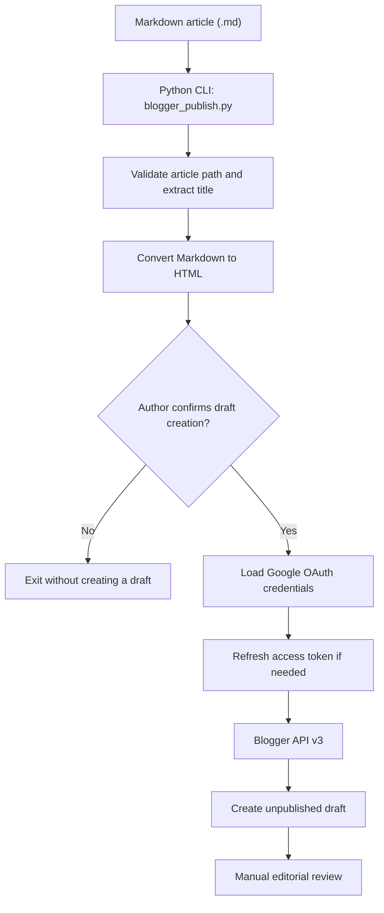

# FASHSYST Technical Publishing Automation

A Python-based workflow that converts Markdown technical articles to HTML and creates **unpublished Blogger drafts** using Google OAuth 2.0 and the Blogger API.

**Built by FASHSYST | Fashel Creations** as a hands-on automation and technical documentation project.

## Problem and objective

Publishing technical articles manually requires repeatedly copying, formatting, and transferring content into a blogging platform. This project creates a reusable command-line workflow so an author can keep articles in version control and submit them for editorial review as drafts.

**Current scope:** manual CLI trigger and draft creation. It does **not** automatically publish articles or distribute them to other platforms.

## Architecture



## Technologies

| Component | Purpose |
| --- | --- |
| Python | CLI orchestration and file processing |
| Markdown | Plain-text article authoring |
| `markdown` package | Markdown-to-HTML conversion |
| Google OAuth 2.0 | Delegated authorization to access the author's Blogger account |
| Google API Python Client | Calls to the Blogger API v3 |
| Git / GitHub | Source control and project documentation |
| WSL Ubuntu / VS Code | Development environment used for this implementation |

## Repository structure

```text
.
├── .gitignore
├── articles/
│   └── publishing-test.md
├── blogger_auth.py
└── blogger_publish.py
```

A local `credentials/` directory and `.venv/` are excluded from Git and must **never** be committed.

## Running locally

**Prerequisites:** Python 3.9+, access to a Blogger blog, and a Google Cloud OAuth desktop client configured with the Blogger API enabled.

1. Create and activate a virtual environment:

   ```bash
   python3 -m venv .venv
   source .venv/bin/activate
   ```

2. Install the required packages:

   ```bash
   python -m pip install google-auth google-auth-oauthlib google-api-python-client markdown
   ```

3. Create a local `credentials/` directory. Put your **own** Google OAuth desktop client JSON there, named `client_secret_*.json`. Do not commit or share it.

4. Complete the OAuth browser authorization flow:

   ```bash
   python blogger_auth.py
   ```

   The script stores a local token in `credentials/token.json` and displays accessible blogs.

5. For a different Blogger account, replace the `BLOG_ID` configuration in `blogger_publish.py` with your own blog ID.

6. Create a Markdown file in `articles/`. The first `# Heading` becomes the Blogger title.

7. Create an unpublished draft:

   ```bash
   python blogger_publish.py articles/publishing-test.md
   ```

   Type `yes` at the prompt. Review the result in Blogger's **Posts → Drafts** dashboard.

**Caution:** Each confirmed run creates a new draft; there is no duplicate-detection mechanism yet.

## What was verified

- Google OAuth authorization completed and Blogger API access was confirmed.
- A first test script created an unpublished Blogger draft.
- The Markdown-based script created a second, separately titled unpublished draft.
- Git ignored `credentials/token.json` and `.venv/`, and the first push contained only the intended source and article files.
- The initial source commit was pushed to the repository's `main` branch.

These are development-lab results, not evidence of a production deployment.

## Security considerations

- OAuth tokens and client-secret JSON files remain local under `credentials/`, excluded via `.gitignore`.
- The publishing command requests explicit confirmation and sends `isDraft=True` to the Blogger API.
- Article paths are constrained to the `articles/` directory.
- An ignore rule is not a complete protection against previously committed secrets. Inspect staged content before every push and rotate any exposed credential.

## Limitations and engineering improvements

- `BLOG_ID` is currently a code-level configuration; move it to environment-based configuration for portability.
- Add automated unit tests for file validation, title extraction, and Markdown conversion.
- Add API error classification, retries where appropriate, logging, and duplicate prevention.
- Pin dependency versions and add continuous integration checks.
- Extend the evidence set with redacted terminal captures, automated test results, and incident/recovery exercises.
- Consider DEV.to or LinkedIn distribution **only after** explicit editorial approval.

## Published project article

**Original technical case study:** [How I Built a Markdown-to-Blogger Publishing Pipeline with Python and Google OAuth 2.0](https://blog.fashelcreations.com/2026/11/how-i-built-markdown-to-blogger.html)

The article describes the implemented architecture, OAuth connection, Markdown conversion, draft-only API submission, verification screenshots, and engineering limitations. The Blogger article is the original publication for any future cross-posts.

## Portfolio evidence

The repository includes two screenshots from the verified development workflow:

1. [Blogger unpublished draft confirmed](docs/screenshots/01-blogger-draft-confirmed.jpg) — shows the Markdown article saved as an unpublished draft in Blogger.
2. [Initial GitHub source push](docs/screenshots/02-github-initial-push.jpg) — shows the dedicated public project repository and initial commit.

For the implementation walkthrough, failure scenarios, and practice interview questions, see the **[Project Study & Interview Guide](docs/PROJECT_STUDY_GUIDE.md)**.

## Interview explanation

> I built a Python command-line workflow to reduce repetitive technical blog preparation. Authors write posts in Markdown, the script validates the file and converts it to HTML, then uses OAuth 2.0 credentials to call the Blogger API and create an unpublished draft. I kept credentials out of Git, added confirmation before the API call, and verified the result in Blogger. My next improvements would be automated tests, environment-based configuration, and stronger error handling.

## Project status

**Working prototype — Blogger draft creation verified.** Portfolio documentation and production-readiness improvements are ongoing.
