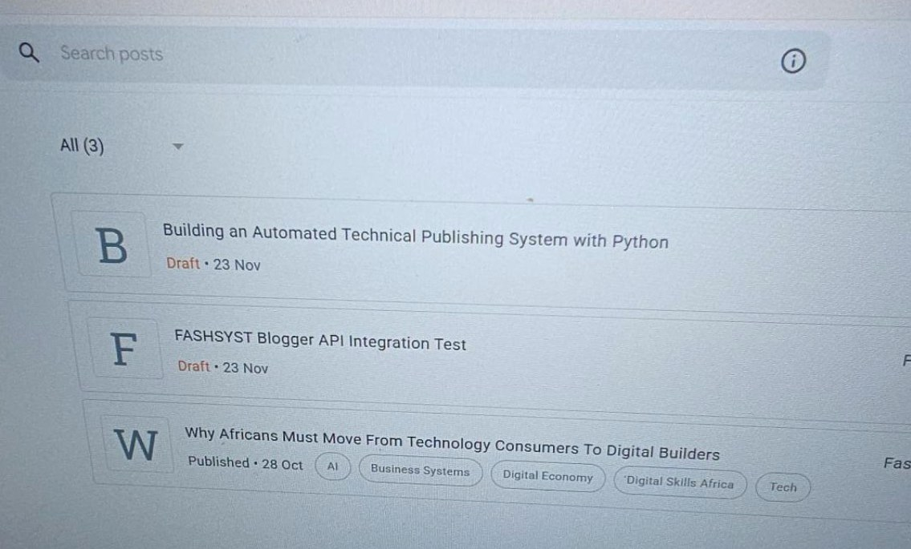
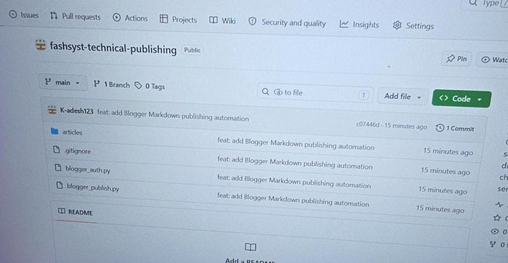

# How I Built a Markdown-to-Blogger Publishing Pipeline with Python and Google OAuth 2.0

*By Fashel Creations | FASHSYST — Digital Systems Builder and Cloud/DevOps Engineer*

Building cloud and automation projects is only part of the work. If I cannot explain what I built, why I made particular decisions, or how I verified the results, the project is much less useful as an engineering portfolio.

I wanted a repeatable way to document technical projects without manually copying and reformatting each article in a blogging dashboard. So I built a small Python-based publishing workflow that turns a Markdown article into an **unpublished Blogger draft**, ready for review.

This is the first version of that system, built and tested in WSL Ubuntu with Python, Google OAuth 2.0, the Blogger API, and GitHub.

## The problem: technical writing shouldn't require repeating the same work

As I build projects in cloud infrastructure, CI/CD, and business automation, each project produces explanations, commands, screenshots, and troubleshooting lessons.

I want those records to remain useful in three places:

- **GitHub**, as version-controlled engineering documentation.
- **My technical blog**, as a readable explanation of the problem and solution.
- **My interview preparation**, as proof that I understand the decisions and trade-offs.

The manual approach would be to write in one place, copy the text into another platform, fix the formatting, and repeat it for every article. I decided to automate the transfer while keeping final publication under human control.

## The architecture

Here is the actual workflow we implemented:

```text
Markdown article (.md)
        |
        v
Python command-line script
        |
        v
Validate article path and read content
        |
        v
Extract heading + convert Markdown to HTML
        |
        v
Ask author to confirm draft creation
        |
        v
Load or refresh Google OAuth credentials
        |
        v
Google Blogger API v3
        |
        v
Create unpublished Blogger draft
        |
        v
Review in Blogger before publishing
```

There are two key Python files in the project:

- `blogger_auth.py` handles the Google OAuth authorization process and checks access to Blogger.
- `blogger_publish.py` reads a selected article, converts it to HTML, and creates an unpublished draft through the API.

**The distinction matters:** authentication establishes authorized access; the publishing script performs the specific operation using that access.

## The tools and why I chose them

| Tool | Role in the workflow |
| --- | --- |
| **Python** | Processes files and makes API calls |
| **Markdown** | Keeps technical writing lightweight and version-controlled |
| **Python `markdown` package** | Converts Markdown into HTML |
| **Google OAuth 2.0** | Grants authorized access without hardcoding a Google password |
| **Blogger API v3** | Creates the draft programmatically |
| **Git and GitHub** | Track code, articles, and verified project evidence |
| **WSL Ubuntu and VS Code** | Local development environment |

I chose a command-line workflow first because it is simple to inspect, inexpensive to run locally, and easy to extend later.

## Step 1: Authorize the application with Google OAuth

The first challenge was getting Python to communicate with the correct Blogger account.

After enabling the Blogger API and configuring a Google OAuth desktop client, I used Google's Python client libraries to complete the browser authorization flow.

The authentication script requests the Blogger permission scope:

```python
SCOPES = ["https://www.googleapis.com/auth/blogger"]
```

When authorization succeeds, the program stores the resulting token locally and can reuse or refresh it in later runs.

The token file lives under `credentials/token.json` on my machine. It is **not** part of the public GitHub repository.

I verified that the API connection could list the blog before moving to article creation.

## Step 2: Store articles separately from application code

My first working test used HTML written directly inside the Python publishing script. That proved the API could create a draft, but it was not reusable.

I improved the design by moving article content into a separate `articles/` directory:

```text
fashsyst-technical-publishing/
├── articles/
│   ├── publishing-test.md
│   └── markdown-to-blogger-automation.md
├── blogger_auth.py
├── blogger_publish.py
├── .gitignore
└── README.md
```

This separates **content** from the **logic that delivers it**.

Now I can create a new Markdown article without changing the Python script.

## Step 3: Validate and convert Markdown

The publishing script accepts a Markdown file path as a command-line argument. It checks that the file exists, has a `.md` extension, contains text, and resolves to a path inside the intended articles directory.

Then the script uses the first Markdown level-one heading as the Blogger title.

A simplified excerpt of the conversion step looks like this:

```python
content = article_path.read_text(encoding="utf-8")

html = markdown.markdown(
    content,
    extensions=["fenced_code", "tables"],
)
```

For example, the Markdown heading:

```markdown
## Building a repeatable workflow
```

becomes an HTML heading that Blogger can display.

This allows articles to contain structured explanations, bullet points, technical tables, and code examples while remaining easy to edit in VS Code.

## Step 4: Create a draft through the Blogger API

After preparing the article, the script explicitly asks whether to create a draft.

Once confirmed, it uses the authenticated Blogger client to submit the title and HTML content:

```python
post = {
    "kind": "blogger#post",
    "title": title,
    "content": html,
}

result = service.posts().insert(
    blogId=BLOG_ID,
    body=post,
    isDraft=True,
).execute()
```

The setting `isDraft=True` is deliberate. **The automation prepares the article, but it does not publish it publicly without review.**

The program then displays the title and Blogger post ID so I can verify the result.

## Step 5: Verify the result instead of assuming it worked

I ran an initial API integration test, followed by a separate test that read a Markdown file.

The second test created a Blogger draft titled **“Building an Automated Technical Publishing System with Python.”** I checked the Blogger Posts dashboard and confirmed the entry was marked **Draft**.



I also initialized a dedicated Git repository, verified that credentials and the Python virtual environment were ignored, and pushed the code to GitHub.



These checks matter because a successful-looking terminal command is not enough evidence on its own. I wanted to verify both the remote result in Blogger and the contents actually stored in GitHub.

## Security decisions and lessons learned

A publishing system needs more than working API calls.

**1. Keep credentials outside source control.** My `.gitignore` excludes `credentials/`, `token.json`, `.env` files, and `.venv/`. I checked Git's staged file list before the first commit.

**2. Review what Git will commit.** The commands `git diff --cached --name-only` and `git status` helped me inspect staged files. Ignore rules do not remove secrets already committed in Git history.

**3. Preserve an approval step.** This prototype creates an unpublished Blogger draft and requires a human to review and publish it.

**4. Verify the remote outcome.** I inspected the Blogger dashboard instead of treating an API response as the only proof of success.

There are also limitations. A confirmed run currently creates a new draft each time, so repeating a command can create duplicates. The code has no automated test suite, no scheduled execution, and no built-in API retry strategy yet. The destination blog ID is still configured in the Python script.

Those are engineering improvements to address, not features I can claim are already implemented.

## What I would improve next

My next development milestones are to:

1. Add automated tests for file validation, title extraction, and Markdown conversion.
2. Make the destination blog configurable without editing application code.
3. Add structured error handling and duplicate-draft protection.
4. Run safe validation checks in GitHub Actions before merging changes.
5. Extend approved article distribution to other platforms while preserving the original source.

I also maintain a project study guide so I can explain how the workflow operates, what could fail, and how I would troubleshoot it in an interview.

## The bigger lesson

This was a small project, but it changed how I think about technical content creation.

Instead of treating documentation as something to do after a project is finished, I am making it part of the engineering process: **build, verify, document, explain, and improve.**

That process helps me grow real DevOps competence while building a portfolio that reflects systems I have actually implemented.

You can explore the code, documentation, architecture, and verification evidence in the [FASHSYST Technical Publishing Automation GitHub repository](https://github.com/K-adesh123/fashsyst-technical-publishing).

*FASHSYST builds digital systems. Fashel Creations shares the skills and thinking behind building them.*
